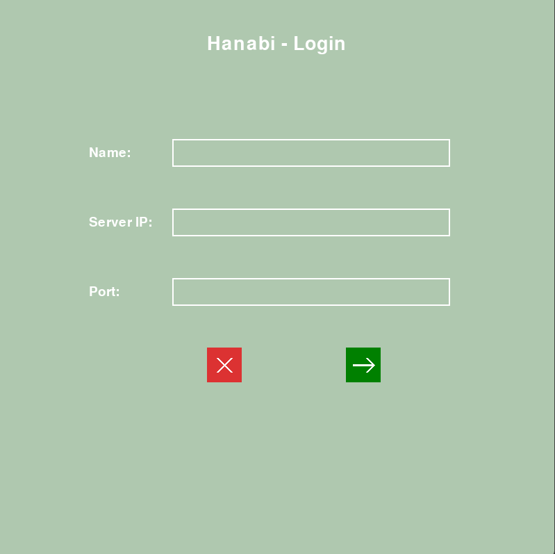
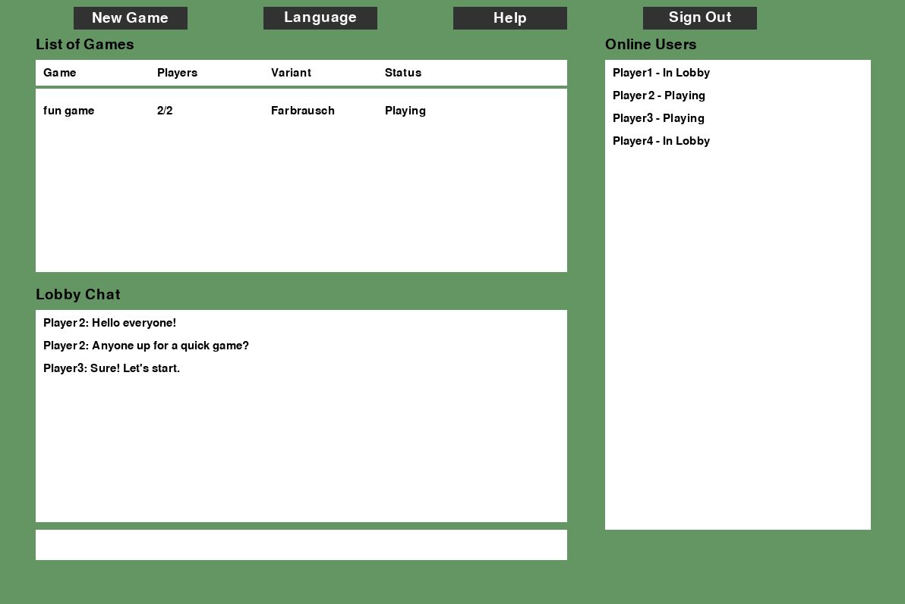
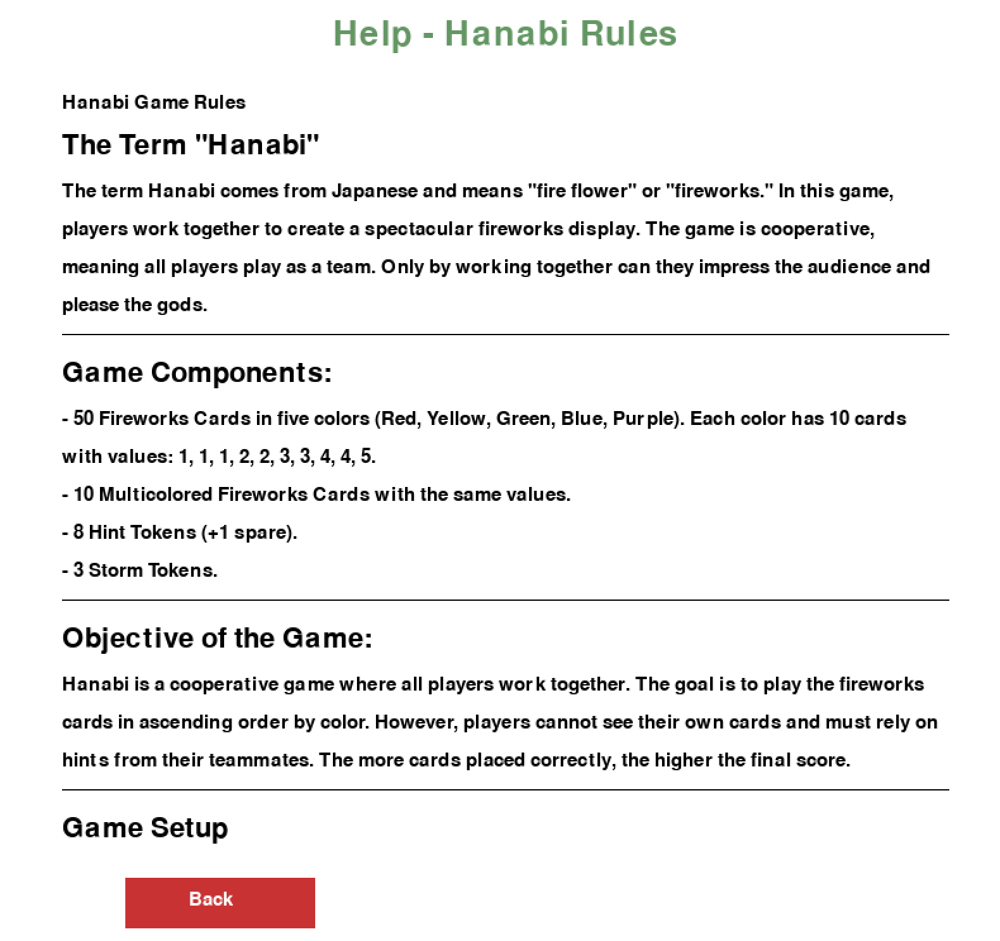
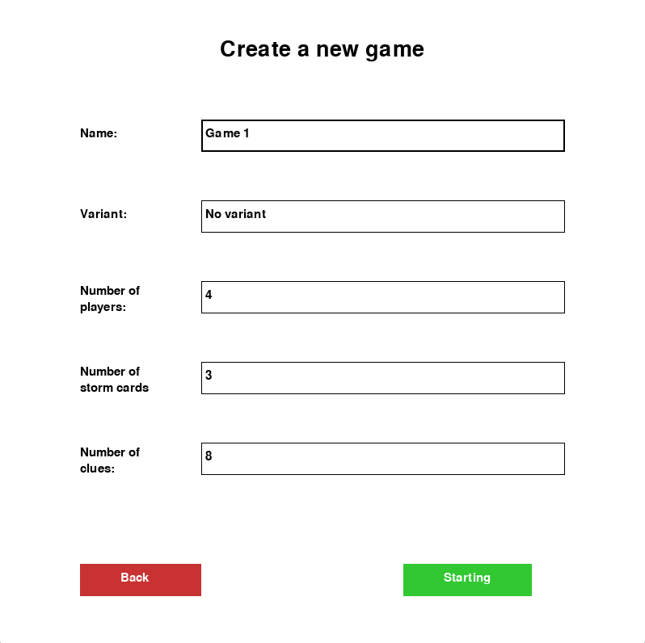
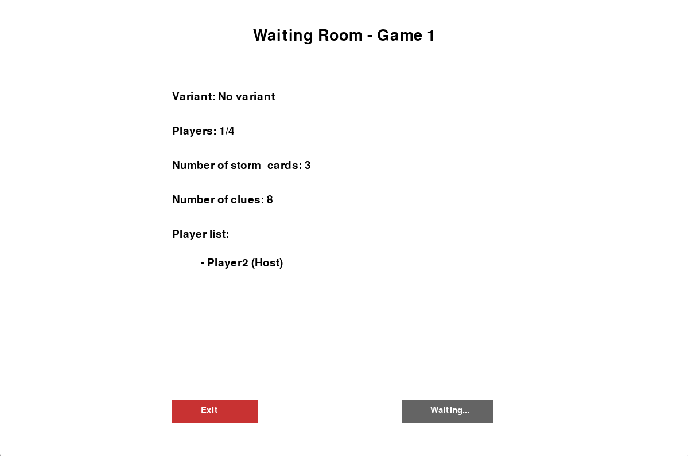
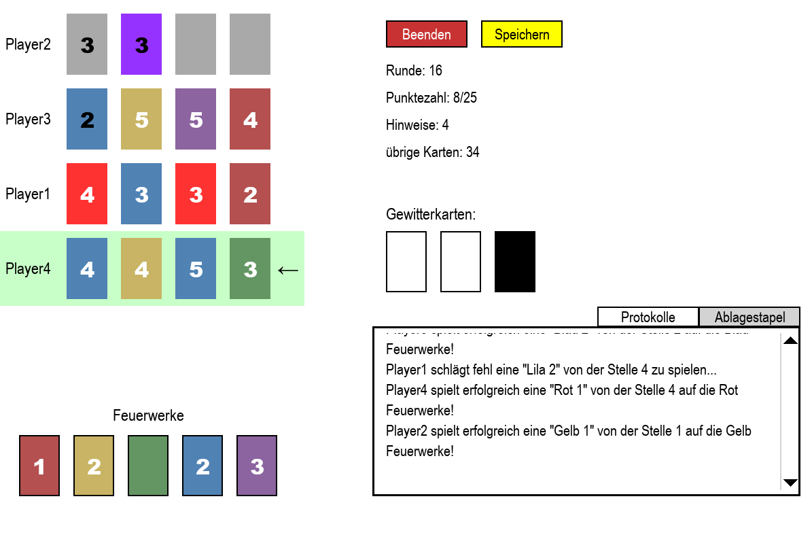
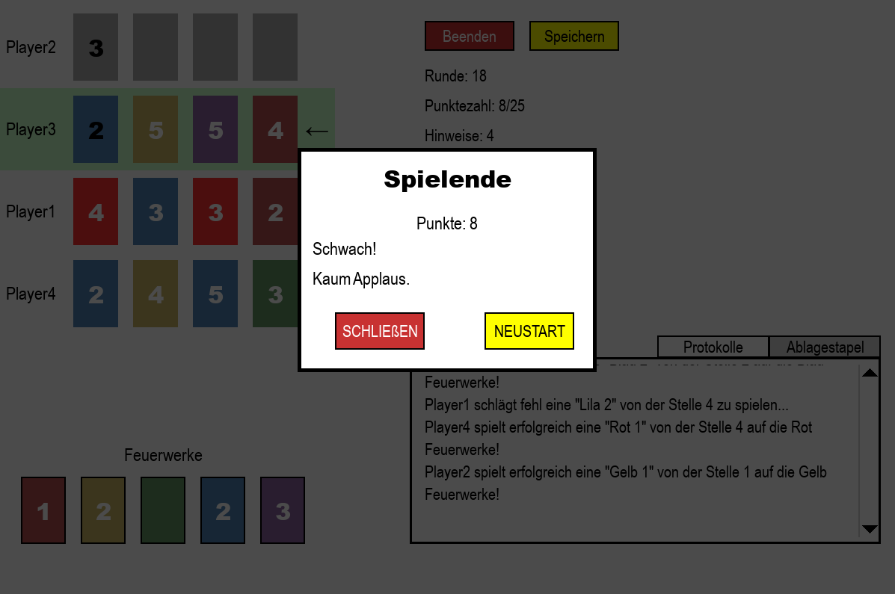

# Hanabi Game Implementation
The implementation of the cooperative card game Hanabi using Python and Pygame. It is a four-person university team project at LMU Munich during the winter semester 2024/25.

## Overview
Hanabi is a cooperative card game where players work together to create perfect firework displays. The unique part is that players can see everyone's cards except their own, requiring careful communication and teamwork.

## Team Contributions

- **Emma** — Testing and German translation.
- **Hanna** — Project structure, prototyping, lobby-to-game integration, and documentation formatting.
- **Kailai** — Client–server communication, messaging protocol, login screen, `config.json`, and real-time lobby synchronization.
- **Yuxin** — Most game screens, core game logic, real-time game-state synchronization, storm cards, game saving, language switching, the Farbrausch variant.

## Features
- Multiplayer support for 2-4 players
- Server-client architecture for network play
- Real-time game state updates
- In-game chat system
- Game state saving
- Interactive GUI with Pygame
- Hint system with color and number clues
- Storm card (life) tracking
- Logging system

## Requirements
- Python 3.8+
- Pygame
- Network connection for multiplayer

## Installation
1. Install Pygame:
`pip install pygame`

2. Clone the repository:
`git clone https://gitlab2.cip.ifi.lmu.de/plai/sep2425/hp2425-4b.git`

3. Run the game:
Use `python server.py` to start the server. Enter the IP address and port number when prompted. Launch client with `python main.py` and connect to join the game lobby.

## Game Rules
The game follows a set of predefined rules. You can read the full rules in your preferred language:
- 🇬🇧 [Rules in English](./src/game/rules_en.txt)
- 🇩🇪 [Spielregeln auf Deutsch](./src/game/rules_de.txt)

## Gameplay Flow
This section walks through the different stages of playing Hanabi:
1. Login Page
When the game starts, the player is presented with a login screen where they enter their **username**, **server IP**, and **port number** to connect.

- Enter Username, Server IP, and Port;
- Click the green button to proceed to the lobby;
- Click the red button to exit the game.

2. Lobby (Game Selection)
After logging in, players are taken to the Lobby, where they can either join an existing game or create a new game.

- Click "New Game" to create a new game；
- Click "Join" to enter an existing waiting room；
- Click "Language" to switch between English and German;
- Click "Help" to view the game rules;
- Click "Sign Out" to log out and return to the login page;
- Use the Chat to communicate with other players in the lobby.

3. Help Page
The Help Page provides a scrollable display of the game rules in either English or German, depending on the selected language. 

- The game rules will be displayed based on the current language setting
    - 🇬🇧 [Rules in English](./src/game/rules_en.txt)
    - 🇩🇪 [Spielregeln auf Deutsch](./src/game/rules_de.txt)

- Click "Back" to return to the lobby.

4. Creating a New Game
If a player chooses to start a new game, they can configure the game settings, including **variant type**, **number of players**, **storm cards**, and **clue limits**.

- Enter a **name** for the game;
- Select game settings (variant, player count, etc.);
- Click "Create" to start the game room.

5. Waiting Room
After creating or joining a game, players enter the Waiting Room, where they wait for all players to join before starting.

- Host can start the game when the required number of players join;
- Players can see game settings and who has joined;
- Click "Exit" to return to the lobby.

6. Playing the Game
Once all players are ready, the game begins! Players can **give clues**, **play cards**, and **discard cards** to build the fireworks.

- The game is turn-based.
- The current player's turn is highlighted.
- Hinted cards will visually change color or number when a clue is given.
- Players can select a card to play, give a clue, or discard a card.

- Click "Logs" to view all previous game actions;
- Click "Discard Pile" to view all discarded cards;
- Click "Save" to save the current game state;
- Click "Exit" to return to the lobby.

7. Game Over / Victory
The game ends when the storm cards run out or when players complete all fireworks successfully.

- Score and final game state are displayed;
- Click "Leave" to return to the lobby;
- Click "Restart" to restart the game if the player is the host.
